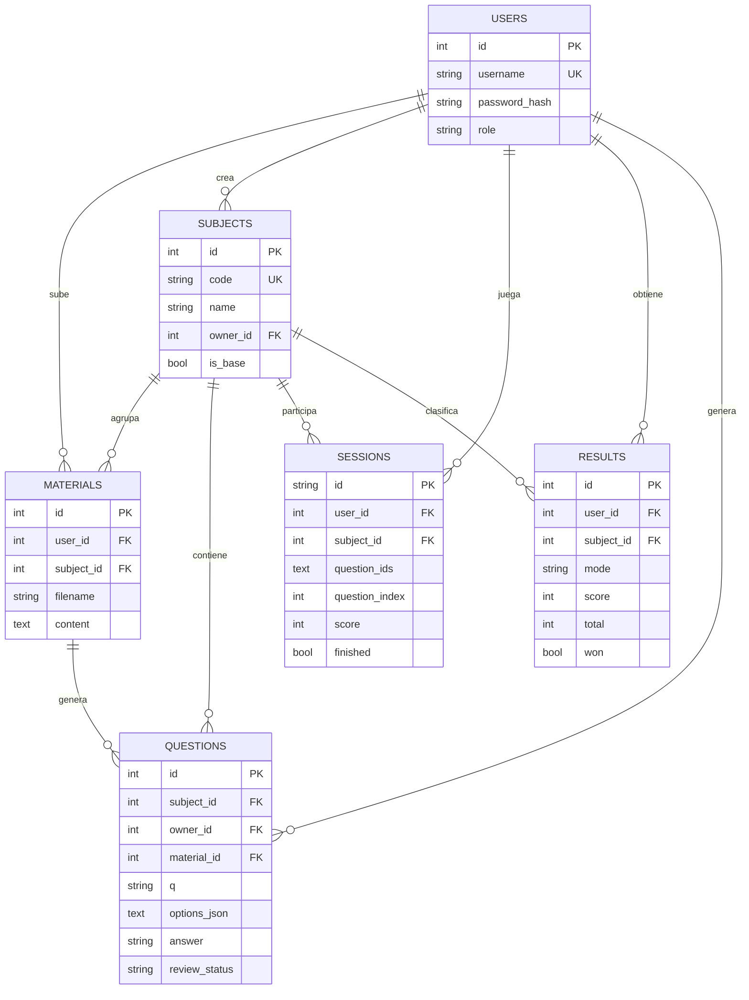

# Base de datos del proyecto — Academia Pixel v8

**Motor:** SQLite. **Archivo:** `data/academia_pixel.sqlite3`. La estructura se crea mediante `init_db()` de `app.py` y usa `PRAGMA foreign_keys = ON`.

## Diagrama entidad-relación simplificado

## Por qué se usan estas tablas

`USERS` guarda los usuarios registrados y su rol. `SUBJECTS` agrupa las cuatro materias originales y las nuevas creadas por estudiantes; el profesor virtual se representa por `boss_name` y `boss_realname` como atributos de materia (simplificación de la relación 1 a 1 de la teoría). `MATERIALS` guarda el texto del apunte extraído y el usuario propietario. `QUESTIONS` guarda cada pregunta, sus cuatro opciones como JSON y la respuesta correcta; además, identifica si fue generada y si el docente la aprobó. `SESSIONS` permite comprobar en el servidor las respuestas de un examen antes de sumar puntos. `RESULTS` representa partidas terminadas, para construir el ranking e historial.

Las salas online y sus conexiones **no se almacenan permanentemente**: se manejan en memoria mientras la partida está activa. Cuando finaliza, se guarda una fila `RESULTS` por participante. En una futura versión pueden añadirse tablas `SALA_MULTIJUGADOR` y `SALA_JUGADOR` para salas persistentes, tal como figura en el documento de análisis actualizado del grupo.

## Diferencias deliberadas respecto del DER de la entrega teórica

- `OPCION` se guarda como `options_json` dentro de `QUESTIONS` en vez de crear una tabla separada. El servidor comprueba que todas las preguntas generadas tengan exactamente cuatro opciones diferentes y una correcta.
- Los profesores virtuales se guardan como dos atributos de `SUBJECTS`; para un sistema que permita gestionar profesores reales haría falta una tabla `PROFESOR` y relación 1 a 1.
- La tabla `PARTIDA_PREGUNTA` se simplificó mediante `SESSIONS.answers_json`, que conserva las opciones elegidas. En un sistema con analítica por pregunta sería preferible normalizarla.
- El backlog actualizado adopta **1 vs. 1 online** aunque uno de los documentos anteriores menciona hasta cuatro jugadores.

Estas elecciones simplifican una demostración funcional y deben reflejarse si el docente solicita un DER estrictamente normalizado con las entidades originales.
